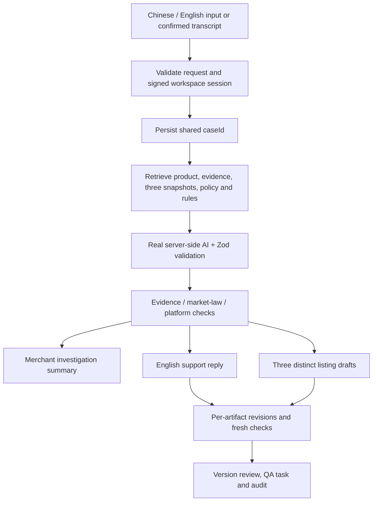

# Architecture and data lifecycle

## Foundation boundary

Next.js App Router, TypeScript, Tailwind, Zod, server-only Supabase client and PostgreSQL migrations. The frontend reads persisted case/workflow API data; only the explicitly labeled example input uses the synthetic fixture. Case, AI summary, generation, revision, review and task handlers have passed real-provider/hosted-Supabase HTTP verification. Text translation is an independent chat-provider operation; previews preserve original inputs and are not persisted. Speech requires its separate service configuration or browser-recognition mode. See WORKFLOW_VERIFICATION_2026-11-01.md for the hosted workflow test boundary.

The merged speech work adds a loopback CPU Whisper service via the dedicated local-STT launcher and an independent browser-recognition mode. Ordinary app startup still needs separate speech configuration. See VOICE_SETUP.md and H18_H24_DELIVERY.md for setup and the teammate's audio/microphone verification; the earlier workflow report describes its original configuration checkpoint.

## Intended completed flow

Findings are advisory risks, not legal certification. Customer observations stay unverified. No external sending, publishing or refunds.

## Persistence

`products` → `evidence_sources`, `platform_listings`, `cases`.

`cases` → `artifacts` → `artifact_versions`. The artifact head has a deferred FK to a real version: create identity/version in one transaction. Composite FKs bind versions, findings, revisions and reviews to their own case.

`rules` stores source/applicability/excerpt/checked date/verification. `findings` targets a source listing and/or artifact version, with separate categories and exact spans. `revision_events` references both versions. `artifact_reviews` records exact version/case reviewed. Tasks/audit share the case.

Audit/revision/review rows are append-only; version content and evidence/listing snapshots are immutable. New sources require new IDs/versions. Rule verification can be updated; when implementing checks, snapshot the rule version, excerpt and checked date used in the audit payload.

`source_ids` uses readable text IDs in arrays. Application/SQL workflow validation binds citations to retrieved case/product/rule context. Committed workflow RPCs lock heads, reject stale edits, atomically append versions/findings/revisions/reviews/audit, and preserve earlier content. Both P2 scalar and P3 JSON operation signatures are supported on confirmed missing-signature responses. Substantive market/platform rule evaluation remains unfinished.

SQL uses snake_case; API DTOs use camelCase. Explicitly map/validate rows.

## Concurrency and review

Generate/validate candidate, lock artifact, recheck `expectedVersion`, insert content/findings/revision/audit, advance head atomically. Failure rolls back all writes. Never allocate versions from stale frontend counts. Old approved versions stay historical; new heads start unapproved.

## Access, secrets and speech

- Service-role/provider keys stay server-only. No `NEXT_PUBLIC_*` credential is needed.
- All business tables have RLS enabled and grants to anonymous/authenticated/PUBLIC revoked. Trusted server uses service role.
- Browser case routes require a signed HttpOnly workspace session issued after Supabase Auth email/password verification and reject cross-origin mutations. Public registration is disabled; users are provisioned by an administrator. A legacy bearer token can remain configured for trusted API clients but is not part of browser sign-in. A role switch is presentation context, not authorization.
- Public health returns availability enums only; configured DB query has a five-second timeout. No row content, credentials or provider errors are returned.
- Speech processing is temporary/in-memory, with no raw audio retention. Confirmed editable transcript enters the existing text workflow.
- Explicit browser recognition mode uses the browser vendor's service and sends no audio to ReLoop. Its disclosure, language, duration, cancellation and result timeouts are handled by the shared VoiceInput component/helper. Backend audio upload remains available for independently configured providers.
- Migration/reset is CLI-only against a dedicated demo project; no public reset route.

## Failure/deployment

Validate requests/model output, preserve last good versions, return sanitized typed errors and allow retry. Never silently substitute a fixture for a failed operation. Missing evidence/rules remain visible. Separate original-listing findings from proposed-draft findings.

Deploy to a Node-capable Next.js host: `npm ci`, `npm run build`, `npm start`. Runtime secrets belong in hosting settings. The compatible organizer chat adapter is verified. This milestone creates no public deployment, marketplace connection or release tag. Hosted schema changes require the database owner's approval. See the final delivery report for deployment gates.
