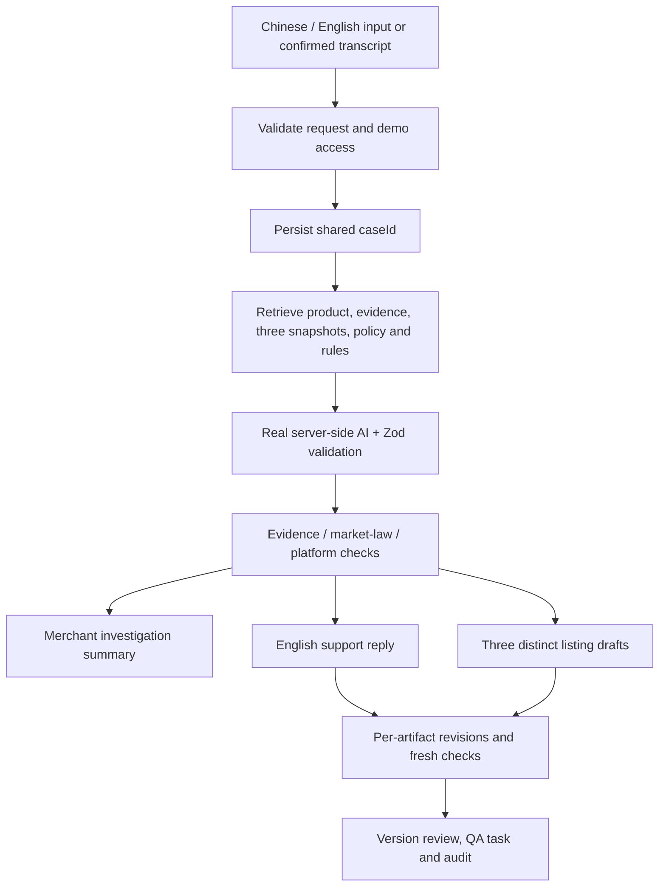

# Architecture and data lifecycle

## Foundation boundary

Next.js App Router, TypeScript, Tailwind, Zod, server-only Supabase client and PostgreSQL migration. Preview reads **original synthetic fixture JSON only**. Health, protected case routes, persisted generation/revision/review routes and the server-side AI/STT adapters use the configured database/provider when credentials are present. The task route remains dependent on the Person 3 implementation.

## Intended completed flow

Findings are advisory risks, not legal certification. Customer observations stay unverified. No external sending, publishing or refunds.

## Persistence

`products` → `evidence_sources`, `platform_listings`, `cases`.

`cases` → `artifacts` → `artifact_versions`. The artifact head has a deferred FK to a real version: create identity/version in one transaction. Composite FKs bind versions, findings, revisions and reviews to their own case.

`rules` stores source/applicability/excerpt/checked date/verification. `findings` targets a source listing and/or artifact version, with separate categories and exact spans. `revision_events` references both versions. `artifact_reviews` records exact version/case reviewed. Tasks/audit share the case.

Audit/revision/review rows are append-only; version content and evidence/listing snapshots are immutable. New sources require new IDs/versions. Rule verification can be updated; when implementing checks, snapshot the rule version, excerpt and checked date used in the audit payload.

`source_ids` uses readable text IDs in arrays. SQL cannot FK every array element: Person 3 must validate every citation and input version against retrieved context. SQL does not independently implement business checking, role authorization, sequential-head locking or atomic orchestration. Those remain feature work.

SQL uses snake_case; API DTOs use camelCase. Explicitly map/validate rows.

## Concurrency and review

Generate/validate candidate, lock artifact, recheck `expectedVersion`, insert content/findings/revision/audit, advance head atomically. Failure rolls back all writes. Never allocate versions from stale frontend counts. Old approved versions stay historical; new heads start unapproved.

## Access, secrets and speech

- Service-role/provider keys stay server-only. No `NEXT_PUBLIC_*` credential is needed.
- All business tables have RLS enabled and grants to anonymous/authenticated/PUBLIC revoked. Trusted server uses service role.
- Case routes require a server-configured `DEMO_ACCESS_TOKEN` as a bearer token and reject cross-origin mutations. A secure login/session UI and provider-call rate limiting are still needed before shared deployment. Never embed the token in frontend code. A role switch is presentation context, not authorization.
- Public health returns availability enums only; configured DB query has a five-second timeout. No row content, credentials or provider errors are returned.
- Speech processing is temporary/in-memory, with no raw audio retention. Confirmed editable transcript enters the existing text workflow.
- Migration/reset is CLI-only against a dedicated demo project; no public reset route.

## Failure/deployment

Validate requests/model output, preserve last good versions, return sanitized typed errors and allow retry. Never silently substitute a fixture for a failed operation. Missing evidence/rules remain visible. Separate original-listing findings from proposed-draft findings.

Deploy to a Node-capable Next.js host: `npm ci`, `npm run build`, `npm start`. Runtime secrets belong in hosting settings. This foundation creates no hosting account, public deployment, marketplace connection or external provider configuration. Apply/seed explicitly; add one real provider adapter after credentials are available.
