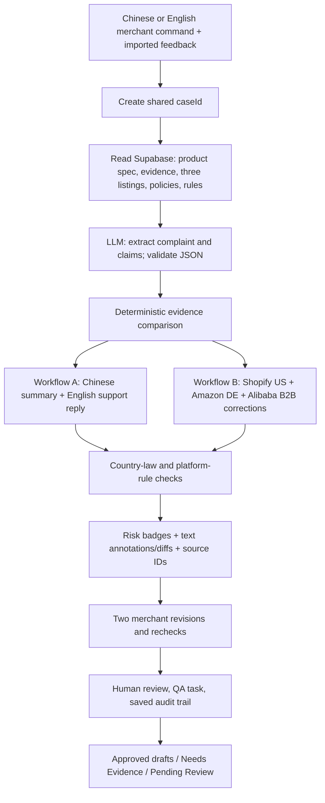

# ReLoop AI — Updated Competition Proposal (v2.0)

**Competition:** 赛道二：AI+出海 (AI for Overseas Business)  
**Prepared:** 31 October 2026  
**Team / time:** 3 human developers, 24 hours, 3-minute live demo  
**Product name:** ReLoop AI — Claim-to-Action  
**Chinese positioning:** 海外客户反馈驱动的跨平台商品承诺纠错与协同系统  
**Status:** Implementation proposal; **not** a claim that these functions already work.

> **One-sentence pitch:** One overseas complaint can expose an inaccurate product promise across **Shopify US, Amazon Germany, and Alibaba International Station**. ReLoop traces the claim to merchant evidence, identifies market and platform risks, drafts channel-specific corrections in prioritized languages, and routes changes through human review.

## 1. Decision summary — what changed

The previous proposal covered Shopify US and Amazon Germany, with English/German outputs. **This version replaces those assumptions throughout**:

| Axis | Revised decision | 24-hour commitment |
|---|---|---|
| Language priority | **1. Chinese (zh-CN) → 2. English (en) → 3. German (de-DE) → 4. Arabic (ar-AE)** | **Chinese and English guaranteed in functional input/output paths**; German and Arabic are explicitly best-effort enhancements. |
| Platform scope | **Shopify US, Amazon Germany, Alibaba International Station (阿里巴巴国际站)** | All **three platform contexts and distinct output formats** must exist, read actual stored listing snapshots, and undergo checks. **No live platform account/API integration** is promised. |
| Workflows | **A. Feedback → Customer Resolution**; **B. Same case → Three-Platform Listing Repair / QA** | Both must run against the same persisted `caseId`. |
| Business roles | Customer Support, Marketing/Marketplace Operations, Quality Assurance, Compliance Reviewer | Roles are **work outputs, decisions, and approval responsibilities**, not four separate login systems. Support and Marketing are essential; QA task and Compliance review must be visibly linked. |
| Validation | 0. **Merchant evidence**; 1. **Country/market law**; 2. **Platform/channel rules** | **1 and 2 are separate competition validation categories**. Evidence checking is the factual foundation; it is **not** itself a separate qualifying category. |
| Feedback & interaction | Risk labels; highlighted before/after differences; **two real user revisions** | Mandatory in working app, versioned and persistent. Chinese/English voice input is a required MVP feature |

**Scope priority rule:** Never compromise the working Chinese/English path or the two validation categories in order to add German, Arabic, animation, or automatic integrations. Do not label an untested output as supported.

## 2. User, business problem, and value

**Primary user:** A Chinese small/medium exporter that lists the same SKU on a US DTC storefront, a German marketplace, and Alibaba.com B2B. Its customer-service, marketing, and product/QA information is scattered across tools.

**Pain:** A customer reports an unexpected product performance issue, but the listing claims causing the expectation may remain unchanged in three channels. Employees reply to messages without checking the specification, channel-specific listing copy, or legal/platform restrictions.

**Specific job ReLoop performs:** Convert a feedback signal into **evidence-linked findings** and **actionable drafts and tasks**, not unsupported claims of defect detection or legal certification.

**Honest value hypothesis:** Faster manual investigation, fewer unsupported draft claims, and better cross-role handoff. A hackathon demo **cannot prove** a return-rate or conversion-rate improvement. Show measured processing time, number of affected listing snapshots, source IDs consulted, and completed approval steps instead.

## 3. Language support: four planned, two guaranteed

**Language priority is Chinese → English → German → Arabic.** It determines development, testing, and fallback order, not the language spoken by every buyer.

| Locale | Expected use | Commitment |
|---|---|---|
| **Chinese (`zh-CN`)** | Merchant commands, investigation explanation, risk summaries, follow-up edits, action labels | **Guaranteed** input + output; tested with Chinese characters end-to-end. |
| **English (`en`, `en-US`)** | Merchant commands, Shopify US support response and listing, Alibaba international B2B listing, rule explanation | **Guaranteed** input + output; platform-appropriate—not a generic translation. |
| **German (`de-DE`)** | Amazon Germany product title/bullets/description; optionally German feedback interpretation | **Target / best effort**. If unavailable, show an honest English *internal correction brief*, not a falsely labeled German or publication-ready listing. |
| **Arabic (`ar-AE`)** | Optional Arabic-speaking B2B buyer reply or Alibaba market-specific draft | **Stretch / best effort**. If enabled: correct RTL layout and an explicit UAE/Arabic locale; do not present it as legally validated for all Arabic-speaking countries. |

**Availability policy:** Language choices have `ready | beta | unavailable` status; unsupported modes are disabled or show a meaningful fallback. A failed German/Arabic generation must **not** block the guaranteed Chinese and English flows. No UI badge may claim four-language completion until all four have passed tests.

**Localization, not literal translation:** Chinese summarizes operational decisions for a domestic merchant; Shopify US copy is consumer-facing; Amazon DE follows the product-detail format and market style; Alibaba.com copy is **B2B**, requiring accurate specs, MOQ and lead times when evidence exists. Arabic is a separate market communication task with RTL, not simply replacing English words.

## 4. Three platform adapters — different business outputs

| Platform | Audience/context | Inputs | Distinct proposed output | Guardrail |
|---|---|---|---|---|
| **Shopify US** | DTC / consumer support and merchant-owned product description | US support ticket; product page snapshot; support policy | **English customer reply** and **US English product-page correction** (features/FAQ/description) | Apply merchant's support policy; don't invent refunds, warranties or sending permissions. |
| **Amazon Germany** | B2C marketplace detail page | German or English stored listing snapshot; product evidence | **Amazon-style listing repair**: title, bullet points, description; German **if verified functional**, otherwise clearly labeled English reviewer brief | Use EU/German market-law references; validate Amazon DE platform rule only if its applicability is verified. No live publishing. |
| **Alibaba International Station (阿里巴巴国际站)** | B2B international wholesale product page | Existing listing, title/specs, catalog, MOQ, lead time, buyer inquiry *if present* | **English B2B listing correction**: supplier-facing title, structured specification/benefit, MOQ/lead-time/claims notes; optional buyer clarification text | Check Alibaba platform rules on product truthfulness / listing fields. Never invent MOQ, prices, certification or supplier capabilities. |

**All three are guaranteed as configured adapters**: each needs a visible platform-specific output card, stored snapshot, evidence reference, rule status, and approval record. This guarantee is for a **working demonstration with imported/seeded snapshots**, **not** for live Shopify/Amazon/Alibaba connectivity. If optional German or Arabic text generation fails, keep platform findings and English reviewer output with truthful status.

**Critical distinction:** Shopify is the merchant's storefront platform, not a single universal consumer advertising rulebook. For Shopify US, the key market-law rule is US FTC advertising substantiation plus the merchant's own support policy. Do **not** invent a “Shopify policy” to create a false compliance warning.

## 5. One demo case, three channels, one SKU

Use **synthetic merchant data**, clearly marked `DEMO / FICTIONAL`; all real rule references are separate official source records.

| Record | Demo value |
|---|---|
| Fictional merchant | Ningbo rechargeable lighting exporter |
| SKU | `RL-LAMP-01` |
| Product evidence `SPEC-001` | Maximum battery runtime **4 hours** *under documented test conditions*; if conditions are absent, use `needs_evidence` |
| Shopify US snapshot | “Up to **12 hours** battery life” |
| Amazon DE snapshot | “Bis zu **12 Stunden** Akkulaufzeit” (German draft/snapshot supplied as demo fixture even if generation is beta) |
| Alibaba International listing | “Rechargeable desk lamp — **12h** runtime”; B2B fields include a documented MOQ, *not* AI-invented values |
| US customer feedback | “My lamp works for only about **2 hours**.” |
| Chinese merchant instruction | `请分析这条客户投诉，对照产品参数检查 Shopify 美国站、Amazon 德国站和阿里巴巴国际站的商品信息，并生成中文结论与英文处理方案。` |
| English merchant instruction | “Investigate this complaint and correct unsupported runtime claims across all three channels.” |

**Reasoning expected:** A listing's 12h claim conflicts with the recorded 4h maximum **only if conditions are comparable**. The customer's 2h experience remains **unverified feedback** that triggers a QA task, **not** a proven defect. The system may propose 4h only when the evidence supports that exact test-condition phrasing; otherwise recommend removing the number and requesting confirmation.

## 6. Two real, connected workflows

### Workflow A — Feedback → Customer Resolution (Customer Support)

1. Merchant selects a feedback source, enters Chinese **or** English instruction, pastes the support ticket, and selects SKU (auto-identification optional). Add microphone input as an alternative to typed Chinese/English instructions.
2. Application creates a persistent `caseId`, timestamps the input, and retrieves product spec, support policy and relevant listing/rule records from Supabase.
3. LLM parses issue/language/claim quantities into a validated JSON structure; deterministic checks compare comparable numbers.
4. UI displays the **Chinese investigation summary**, raw customer testimony, evidence IDs, confidence *as evidence state* (not a fake probability), and missing information.
5. AI generates an **English Shopify US support reply** that acknowledges the issue, asks needed questions, and stays inside approved support policy. Merchant may produce Chinese internal notes.
6. Merchant issues **two sequential follow-up instructions** (Chinese or English): draft v1 → v2 → v3; versions, prompts and validation outcomes persist.
7. Human Support reviewer marks the artifact `approved` or `requires_changes`; app does not send a message.

**Guaranteed outputs:** Chinese case summary, English support draft, persisted revision history, two feedback methods and review state.

### Workflow B — Cross-Platform Audit → Listing Repair / QA (Marketing + QA + Compliance)

1. Opens **the same `caseId`** and retrieves the Shopify, Amazon DE, and Alibaba International listing snapshots plus master product evidence.
2. Extracts explicit claims and aligns units/test conditions; shows a comparative table and source-linked findings per platform.
3. Generates three **distinct output structures**: Shopify consumer-description repair, Amazon DE structured marketplace repair/reviewer brief, Alibaba B2B specification/listing repair.
4. Checks **(a) market advertising law** scoped to US and Germany/EU, and **(b) specific platform listing rules** scoped to Alibaba and verified Amazon DE rules where available.
5. Shows red/amber/green **risk labels** and **inline proposed-text changes**, with rule IDs, source URLs, market applicability and whether a rule was verified.
6. Marketing reviews each proposed platform output. Compliance Reviewer checks unresolved legal/platform flags. QA receives an investigation task for the unverified 2h customer report.
7. Approvals, rejections, notes, tasks and audit events are persisted against one case. No external listing is published.

**Guaranteed outputs:** Three platform-specific stored drafts/reviewer briefs and visible checks; German/Arabic natural-language generation remains staged by availability.

## 7. What “two validation categories” actually means

**Three separate layers are displayed. Only the last two are the organizer's qualifying categories.**

| Layer | Real question | Demo rule/action | Counts as a distinct organizer category? |
|---|---|---|---|
| **0. Evidence integrity** | “Does our own documentation support the 12-hour claim?” | Compare numeric claim + unit + conditions with versioned `SPEC-001`; status `documented_mismatch`, `needs_evidence`, or `unverified_observation` | **No** — technical correctness/factual foundation |
| **1. Country/market law** | “Could the claim be misleading or inadequately substantiated for buyers in this market?” | **US:** FTC truth-in-advertising and substantiation; **Germany B2C:** EU Unfair Commercial Practices Directive, Art. 6, with Germany applicability review | **Yes** — target-country/market compliance |
| **2. Platform/channel rules** | “Does the proposed listing meet the applicable marketplace's published rules?” | **Alibaba International:** product information truthfulness / listing fields; **Amazon DE:** only rules captured and confirmed as applicable to DE | **Yes** — platform rules |

**Example:** `12h > 4h` is an *evidence finding*. With an applicable FTC or EU advertising-law reference, it becomes a **potential market-law risk**. On an Alibaba listing, a source-backed truthful-product-information rule makes it a **platform-rule risk**. These are separately returned findings with different `category`, `ruleId`, `applicability`, `sourceUrl`, and human review status. A single contradiction can support both, but one check may not masquerade as two independently verified laws.

**Restrictions:** These are risk flags, **not legal determinations**. The AI cannot certify a product or predict enforcement. Rules must have source identity, jurisdiction/platform, version or checked date, direct reference, excerpt, applicability, and `verified | needs_verification` status. A rule that cannot be verified is shown as **Needs Rule Verification**, not “passed.”

### Source inventory to load and verify

| Seed rule ID | Intended scope | Credible starting source | Note |
|---|---|---|---|
| `LAW-US-FTC-001` | US consumer claims (Shopify US) | [FTC — Advertising FAQ](https://www.ftc.gov/business-guidance/resources/advertising-faqs-guide-small-business) and [FTC substantiation policy](https://www.ftc.gov/legal-library/browse/ftc-policy-statement-regarding-advertising-substantiation) | Evidence for objective product-performance claims. |
| `LAW-EU-UCPD-001` | EU/German **B2C** product claims (Amazon DE) | [European Commission — UCPD overview](https://commission.europa.eu/law/law-topic/consumer-protection-law/unfair-commercial-practices-and-price-indication/unfair-commercial-practices-directive_en); [EUR-Lex Directive 2005/29/EC](https://eur-lex.europa.eu/legal-content/EN/TXT/?uri=CELEX:32005L0029) | Article 6 main characteristics; review any amendments/current application. **Do not automatically apply B2C law to Alibaba B2B.** |
| `PLAT-ALI-001` | Alibaba International merchant product information | [Alibaba International merchant agreement](https://terms.alicdn.com/legal-agreement/terms/suit_bu1_b2b/suit_bu1_b2b202111301159_44306.html) | Clauses 7.1.2 / 7.1.3 / 7.5 include avoiding misleading promotion and accurate product information. Check current agreement applicability. |
| `PLAT-ALI-002` | Alibaba listing formatting and truthful MOQ/description | [Alibaba.com official explanatory page](https://activity.alibaba.com/pc/02ade148.html) and [current rules center](https://rulechannel.alibaba.com/) | Explanatory page is older; **reverify the operative current rule** before labeling a violation. |
| `PLAT-AMZ-DE-001` | Amazon Germany detail page rules | [Amazon DE Seller Central help](https://sellercentral.amazon.de/help/hub/reference/external/G200335450) | Page may require login/JS. **Treat as unverified until team captures applicable DE text or organizer supplies help-center excerpt.** Do not substitute US rule as German law. |
| `POLICY-MERCHANT-001` | Shopify support reply | Merchant's *fictional* documented support policy | Internal policy, **not** a separate market-law category. |

For rule interpretation, reference source URLs and appropriate applicability. Some marketplace rules change and can require merchant login; **Person 3 must verify before asserting a definite platform violation**. Shopify US doesn't need an invented universal Shopify claim policy because FTC is a genuine market-law source and Alibaba supplies a separate verified platform-rule category.

## 8. Feedback, conversational iteration, and human approvals

**Two required feedback methods:** (1) severity badges (`info`, `warning`, `blocker`); (2) **text annotations/side-by-side before-after diff** that highlights the exact unsupported phrase and proposed replacement. Either one alone is insufficient.

**Two user-driven dialogue revisions:** A user must be able to enter free-text follow-ups (Chinese **or** English) and see **at least three persisted versions** for the *same artifact*: `v1 → v2 → v3`; rerun validation after **each**. Example prompts: `请缩短回复，并说明需要确认电池测试条件。` then `不要承诺退款，并要求客户提供订单号。` A prewritten button sequence without actual dialogue does not satisfy this requirement as convincingly.

**Approval states:** `draft`, `pending_review`, `approved`, `changes_requested`, `blocked`. “Approved” means internally approved as a draft, **not** automatically sent/published. Any blocker or missing evidence must remain visibly open until reviewed; human approval alone does not convert an unknown claim into a fact.

## 9. Minimum information architecture and API design

**Chosen stack:** Next.js App Router + TypeScript + Tailwind + Zod + Supabase Postgres; a single server-side LLM adapter supporting configured keys, with model selection hidden from end users. No vector database, web crawler or marketplace publishing API required.

**Records/tables (or documented equivalents):**

- `products`: `id, sku, merchant_id, name, attributes_json, source_version`.
- `evidence_sources`: `id, sku, kind, content, numeric_claim_json, test_conditions, provenance, reviewed_at, verification_status`.
- `platform_listings`: `id, sku, platform [shopify_us|amazon_de|alibaba_intl], market, locale, segment [b2c|b2b], fields_json, snapshot_version, source_id`.
- `cases`: `id, sku, channel, feedback_text, feedback_locale, merchant_instruction, merchant_locale, status, created_at`.
- `rules`: `id, category [market_law|platform_rule|merchant_policy], market, platform?, segment, source_url, excerpt, checked_at, verification_status`.
- `artifacts`: `id, case_id, platform?, kind, locale, status, version, fields_json, text, source_ids, created_at`.
- `findings`: `id, case_id, artifact_id?, category [evidence|market_law|platform_rule], severity, code, rule_id?, source_ids, original_span, proposed_span?, explanation_zh, explanation_en, rule_status`.
- `revision_events`: `id, case_id, artifact_id, prompt_text, prompt_locale, from_version, to_version, created_at`.
- `tasks`: `id, case_id, assigned_role, kind, title, description, state, evidence_ids, created_at`.
- `audit_events`: `id, case_id, actor_role, action, entity_id, payload_json, created_at`.

**Minimum APIs:**

| Endpoint | Responsibility |
|---|---|
| `GET /api/health` | DB/model configuration health, no secrets |
| `POST /api/cases` | Chinese/English instruction + feedback + SKU + source → saved `caseId` |
| `GET /api/cases/:id` | One case plus three listing snapshots, evidence, artifacts, findings, tasks |
| `POST /api/cases/:id/analyze` | Actual retrieval + model parsing + evidence integrity findings + Chinese/English summary |
| `POST /api/cases/:id/support` | English Shopify support draft v1, linked to case |
| `POST /api/cases/:id/repair` | Three platform-specific drafts/reviewer briefs with rule checks |
| `POST /api/artifacts/:id/revise` | Chinese/English follow-up text → new persisted version + revalidation |
| `POST /api/artifacts/:id/review` | Human approval/rejection/changes-requested → saved audit event |
| `POST /api/cases/:id/tasks` | Create/update visible QA/compliance follow-up task |

**Response semantics:** Return `caseId`, `status`, `artifacts[]` with `{platform, locale, languageStatus, version, fields}`, `findings[]` with `{category, severity, sourceIds, ruleId, ruleVerified, span, explanation}`, and `error` with `{code,message,retryable}`. Validate request/LLM JSON with Zod; never return `status: success` on absent evidence or unavailable rules. Preserve the last valid version on failure.

**Two distinct role workflows:** `support` and `repair` share case and evidence, not two separate chat sessions dressed up as workflows. `Compliance Reviewer` and `QA` appear as approval/task roles inside the same case; multi-user RBAC is not required in the demo.

## 10. UI: exactly three primary screens

1. **Global Feedback Inbox:** Chinese/English instruction input; source/channel and SKU selection; complaint paste; saved cases; three-platform overview.
2. **Claim Investigation:** Merchant-language summary; evidence trace; product spec and test conditions; three listing snapshot cards; mismatch and uncertainty; source URLs/IDs.
3. **Fix & Approve:** Tabs `Shopify US`, `Amazon DE`, `Alibaba International`; English support reply; separate listing-format drafts; risk badges + highlighted edits; locale availability; **two** chat revisions; QA task; approval and audit history.

**Optional:** German/Arabic selection only when ready; Arabic `dir="rtl"` for content without flipping the whole dashboard. Do not spend time on extra dashboards, live marketplace connections, upload parsing, external sending/publishing or complex access controls.

## 11. Demonstration, evaluation, success criteria

### 3-minute stage plan

| Time | What the judge sees |
|---|---|
| `0:00–0:20` | Ningbo exporter, repeated unsupported performance claim across three channels. |
| `0:20–0:55` | Merchant types **Chinese** request; case created; actual spec/listing/rule retrieval; 12h vs 4h evidence mismatch; customer 2h remains unverified. |
| `0:55–1:20` | Workflow A: **English** Shopify support draft; Chinese summary and risk labels. |
| `1:20–2:05` | Workflow B: three distinct corrections—US Shopify B2C, Amazon DE structured listing/reviewer brief, Alibaba International B2B—and before/after annotations. |
| `2:05–2:40` | Two **typed Chinese revisions**, source-linked country/platform checks, task, internal approval and saved versions. |
| `2:40–3:00` | Shared case timeline, measured processing time, evidence/rule IDs and statuses. No fabricated sales uplift. |

**Demo reliability:** Preseed one case and three platform snapshots; permit repeatable reset. Actual DB reads and model call must be visible (status indicators or audit log). If model fails, present a **clearly labeled** previously generated fallback, never represent recorded output as a live success.

### Competition mapping — based on the supplied brief

| Mandatory / scoring expectation | How ReLoop proves it |
|---|---|
| Chinese/target-language input | Chinese **and English** merchant command validated. |
| ≥2 languages **or** ≥2 roles/scenarios | Chinese + English guaranteed; four business-role outputs; German/Arabic optional. |
| ≥2 platforms/scenarios, localized | **Three distinct platforms**, their listing formats, and B2C/B2B distinction. |
| ≥2 validation categories | Source-backed **market law** and **platform rules** as separate classified findings. |
| ≥2 feedback methods | **Risk labels** + **annotated text comparison**. |
| ≥2 dialogue rounds | Persisted `v1 → v2 → v3`, validation rerun on each. |
| Configured AI/knowledge | Real LLM invocation and real database/spec/rule lookup. |
| Two connected workflows | Support and repair operating on one saved `caseId`. |
| Stable live demonstration | Fixed seeds, error handling, two end-to-end rehearsal runs. |
| Explain data movement and failures | API/schema diagram, source trace, missing data/provider outage behavior. |

### Nonnegotiable acceptance tests

- [ ] `A01` Chinese merchant input saves and produces an accurate Chinese explanation.
- [ ] `A02` English merchant input saves and produces an English explanation.
- [ ] `A03` Guaranteed English Shopify support draft generated with real model call.
- [ ] `A04` Three **different** platform listing outputs read the corresponding stored snapshot.
- [ ] `A05` Alibaba International result is explicitly B2B (MOQ, verified specs, buyer use), not a copied Shopify description.
- [ ] `A06` Amazon Germany result displays `languageStatus` honestly; German output is only called supported if tested.
- [ ] `A07` 12h vs 4h fact mismatch only when test conditions comparable; customer 2h stays unverified.
- [ ] `A08` `market_law` finding references FTC (US) or verified EU rule (Germany) with market scope.
- [ ] `A09` `platform_rule` finding references verified Alibaba International or Amazon DE rule with source and applicability.
- [ ] `A10` Both risk badges and inline before/after annotations render.
- [ ] `A11` Two actual typed chat prompts create persisted versions 1, 2 and 3 and recheck them.
- [ ] `A12` Both workflows share same `caseId`, and QA task/approvals remain after reload.
- [ ] `A13` Missing evidence and unverified rules return `needs_evidence`/`needs_rule_verification` without fake compliance success.
- [ ] `A14` Unknown SKU, model timeout and invalid model output show recoverable errors.
- [ ] `A15` After seed/reset, two complete demos work without manual DB editing.
- [ ] `A16` Chinese and English UX copy has no placeholders or broken encoding.
- [ ] `A17` Arabic, if enabled, displays properly right-to-left and is identified with a real locale.
- [ ] `A18` Generated outputs are drafts and cannot send/publish/refund automatically.

## 12. 24-hour implementation and scope cuts

| Hour | Gate |
|---|---|
| `H0–H2` | Commit frozen case/listing/rules schema, platform adapters and language availability contract. Private GitHub repo; three feature branches. |
| `H2–H6` | Chinese+English inputs; real seeded DB reads; evidence comparison; support flow. |
| `H6–H10` | Three platform adapters render separate structured draft outputs; market-law and Alibaba platform checks. |
| `H10–H14` | Two revisions; versioning; risk feedback; approval and QA tasks; rerun checks. |
| `H14–H18` | Integrated main, negative tests, deployment, rollback, two demo rehearsals; **feature freeze**. |
| `H18–H24` | Poster (0.8 × 1.8 m), 3-minute deck and script, README, configuration/dependency declaration, repo tag `hackathon-final`, final checks. |

**Cut in this order if behind:** Arabic → optional German generation (keep Amazon DE context and reviewer brief) → extra analytics/design polish → optional buyer message → automatic language detection (use locale picker). **Never cut:** Chinese+English paths, three distinct platform contexts, the two workflows, one saved case, both validation categories, two feedback formats, two revisions, actual LLM+DB calls, human review or error states, voice input.

**Final deliverables:** Source repository, runnable project, README, configuration export / `.env.example` without secrets, third-party component declaration, test evidence, 0.8 × 1.8 m poster, 3-minute presentation, and Git tag `hackathon-final`.

## 13. What is intentionally *not* promised

No automatic live Shopify/Amazon/Alibaba read or write; no guaranteed German/Arabic generation; no automatic customer messages; no product defect diagnosis; no guarantee of legal compliance; no invented commercial prices/MOQs or certifications; no claim of proven sales/return improvements. Permissioned account/API integrations may be future work only.

---

## Source provenance

**Organizer requirements:** Supplied competition text and three rubrics in the project conversation. Their minimum is Chinese **or** target-language input; ≥2 languages **or** ≥2 roles/scenarios; ≥2 platforms **or** scenarios; ≥2 qualifying validation categories; ≥2 feedback forms; ≥2 conversational rounds; live AI/KB use and two workflows. These documents deliberately **exceed** several minimums.

**External references for rule seeding (verify scope/recency during implementation):** [FTC advertising FAQ](https://www.ftc.gov/business-guidance/resources/advertising-faqs-guide-small-business), [FTC substantiation](https://www.ftc.gov/legal-library/browse/ftc-policy-statement-regarding-advertising-substantiation), [European Commission UCPD](https://commission.europa.eu/law/law-topic/consumer-protection-law/unfair-commercial-practices-and-price-indication/unfair-commercial-practices-directive_en), [Alibaba International merchant service agreement](https://terms.alicdn.com/legal-agreement/terms/suit_bu1_b2b/suit_bu1_b2b202111301159_44306.html), [Alibaba explanatory listing page](https://activity.alibaba.com/pc/02ade148.html), and [Amazon DE Seller Central](https://sellercentral.amazon.de/help/hub/reference/external/G200335450) (may require login; applicability not verified by this document).

### Voice Input — Mandatory MVP Capability

ReLoop supports Chinese and English microphone input.

Voice processing:
1. User selects Chinese or English.
2. User clicks the microphone.
3. Application records the spoken instruction.
4. Speech-to-text converts audio into text.
5. Transcription appears in the existing text input.
6. User can edit and confirm the transcript.
7. Confirmed text enters the existing AI workflow.

Voice input must support initial analysis requests and
both conversational revision rounds.

The application must request microphone permission, indicate
recording status, provide stop/cancel controls, handle transcription
errors, and offer text input as fallback.

Raw audio must not be retained by the application after processing
unless a separate retention requirement is explicitly approved.