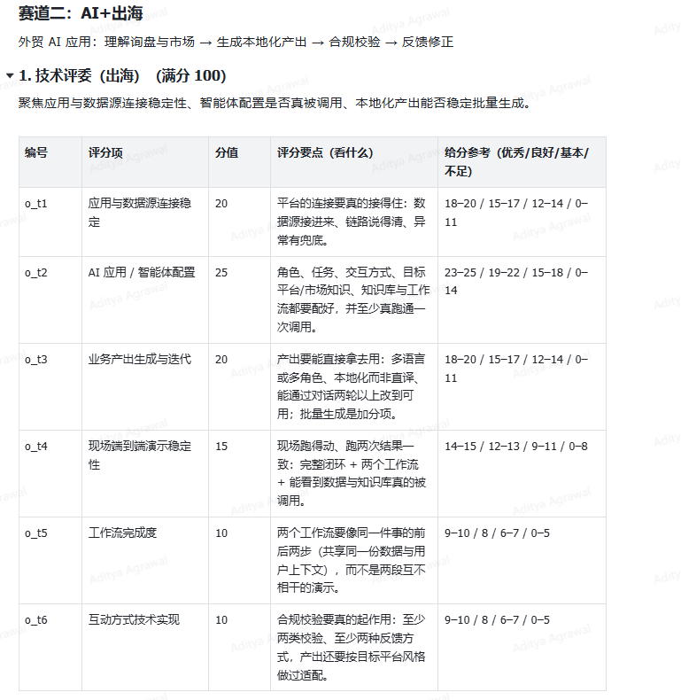
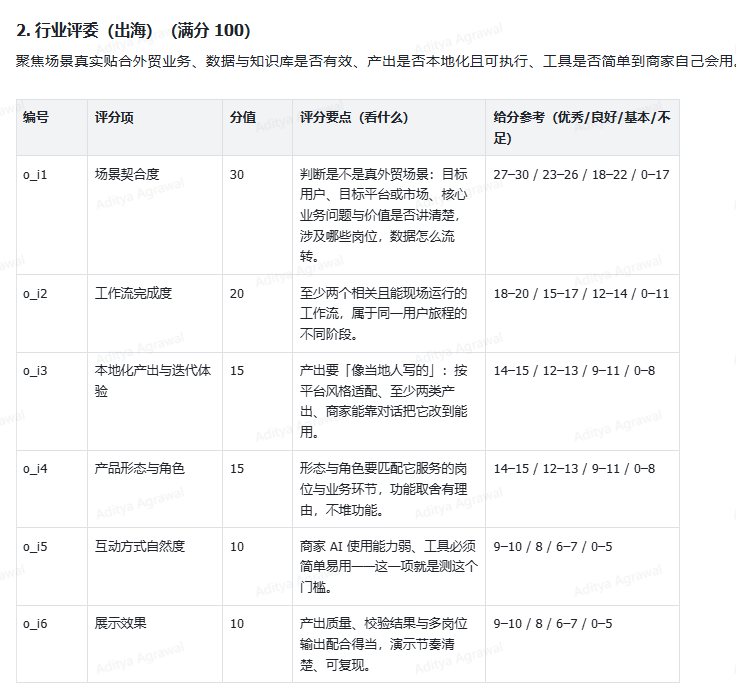
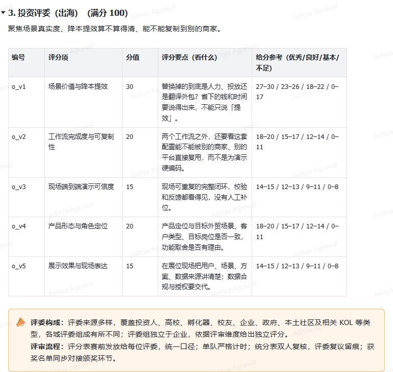

# 赛道二：AI+出海 — 原始评审细则（用户截图转录）

> **Source status:** Transcribed from the three original PNG screenshots provided by the participant, included in this package. This is not a new scoring model, a ReLoop-specific interpretation, or an independently verified official posting. Source image filenames: `Original_Rubric_1_Technical.png`, `Original_Rubric_2_Industry.png`, `Original_Rubric_3_Investor.png`.

原截图标题：**赛道二：AI+出海**

原截图副标题：**外贸 AI 应用：理解询盘与市场 → 生成本地化产出 → 合规校验 → 反馈修正**

## 1. 技术评委（出海）（满分 100）

聚焦应用与数据源连接稳定性、智能体配置是否真被调用、本地化产出能否稳定批量生成。

| 编号 | 评分项 | 分值 | 评分要点（看什么） | 给分参考（优秀 / 良好 / 基本 / 不足） |
|---|---|---:|---|---|
| o_t1 | 应用与数据源连接稳定 | 20 | 平台的连接要真的接得住：数据源接进来、链路说得清、异常有兜底。 | 18–20 / 15–17 / 12–14 / 0–11 |
| o_t2 | AI 应用 / 智能体配置 | 25 | 角色、任务、交互方式、目标平台/市场知识、知识库与工作流都要配好，并至少真跑通一次调用。 | 23–25 / 19–22 / 15–18 / 0–14 |
| o_t3 | 业务产出生成与迭代 | 20 | 产出要能直接拿去用：多语言或多角色、本地化而非直译、能通过对话两轮以上改到可用；批量生成是加分项。 | 18–20 / 15–17 / 12–14 / 0–11 |
| o_t4 | 现场端到端演示稳定性 | 15 | 现场跑得动、跑两次结果一致：完整闭环 + 两个工作流 + 能看到数据与知识库真的被调用。 | 14–15 / 12–13 / 9–11 / 0–8 |
| o_t5 | 工作流完成度 | 10 | 两个工作流要像同一件事的前后两步（共享同一份数据与用户上下文），而不是两段互不相干的演示。 | 9–10 / 8 / 6–7 / 0–5 |
| o_t6 | 互动方式技术实现 | 10 | 合规校验要真的起作用：至少两类校验、至少两种反馈方式，产出还要按目标平台风格做过适配。 | 9–10 / 8 / 6–7 / 0–5 |

**小计：100 分。**

## 2. 行业评委（出海）（满分 100）

聚焦场景真实贴合外贸业务、数据与知识库是否有效、产出是否本地化且可执行、工具是否简单到商家自己会用。

| 编号 | 评分项 | 分值 | 评分要点（看什么） | 给分参考（优秀 / 良好 / 基本 / 不足） |
|---|---|---:|---|---|
| o_i1 | 场景契合度 | 30 | 判断是不是真外贸场景：目标用户、目标平台或市场、核心业务问题与价值是否讲清楚，涉及哪些岗位，数据怎么流转。 | 27–30 / 23–26 / 18–22 / 0–17 |
| o_i2 | 工作流完成度 | 20 | 至少两个相关且能现场运行的工作流，属于同一用户旅程的不同阶段。 | 18–20 / 15–17 / 12–14 / 0–11 |
| o_i3 | 本地化产出与迭代体验 | 15 | 产出要「像当地人写的」：按平台风格适配、至少两类产出、商家能靠对话把它改到能用。 | 14–15 / 12–13 / 9–11 / 0–8 |
| o_i4 | 产品形态与角色 | 15 | 形态与角色要匹配它服务的岗位与业务环节，功能取舍有理由，不堆功能。 | 14–15 / 12–13 / 9–11 / 0–8 |
| o_i5 | 互动方式自然度 | 10 | 商家 AI 使用能力弱，工具必须简单易用——这一项就是测这个门槛。 | 9–10 / 8 / 6–7 / 0–5 |
| o_i6 | 展示效果 | 10 | 产出质量、校验结果与多岗位输出配合得当，演示节奏清楚、可复现。 | 9–10 / 8 / 6–7 / 0–5 |

**小计：100 分。**

## 3. 投资评委（出海）（满分 100）

聚焦场景真实度、降本提效算不算得清、能不能复制到别的商家。

| 编号 | 评分项 | 分值 | 评分要点（看什么） | 给分参考（优秀 / 良好 / 基本 / 不足） |
|---|---|---:|---|---|
| o_v1 | 场景价值与降本提效 | 30 | 替换掉的到底是人力、投放还是翻译外包？省下的钱和时间要说得出来，不能只说「提效」。 | 27–30 / 23–26 / 18–22 / 0–17 |
| o_v2 | 工作流完成度与可复制性 | 20 | 两个工作流之外，还要看这套配置能不能被别的商家、别的平台直接复用，而不是为演示硬编码。 | 18–20 / 15–17 / 12–14 / 0–11 |
| o_v3 | 现场端到端演示可信度 | 15 | 现场可重复的完整闭环，校验和反馈都看得见，没有人工补位。 | 14–15 / 12–13 / 9–11 / 0–8 |
| o_v4 | 产品形态与角色定位 | 20 | 产品定位与目标外贸场景、客户类型、目标岗位是否一致，功能取舍是否有理由。 | 18–20 / 15–17 / 12–14 / 0–11 |
| o_v5 | 展示效果与现场表达 | 15 | 在展位现场把用户、场景、方案、数据来源讲清楚，数据合规与授权要交代。 | 14–15 / 12–13 / 9–11 / 0–8 |

**小计：100 分。**

### 原截图附注：评委构成与评审流程

**评委构成：** 评委来源多样，覆盖投资人、高校、孵化器、校友、企业、政府、本土社区及相关 KOL 等类型，各城评委组成有所不同；评委组独立于企业，依据评审维度给出独立评分。

**评审流程：** 评分表赛前发给每位评委，统一口径；单项严格计时；统分表双人复核，评委复议留痕；获奖名单同步对接颁奖环节。

### 说明

- Each judging group has its own 100-point rubric. The provided screenshots **do not state** how those groups' scores are weighted or aggregated into a final score.
- The screenshot wording defines 2+ rounds of dialogue iteration and 2 linked workflows; it **does not** make voice input compulsory.
- If any transcription conflicts with the PNG source, treat the original PNG as authoritative.
- These images were provided by the participant; their provenance has not been independently established by an official organizer URL.
